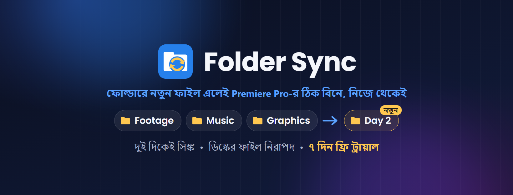

# Folder Sync — Adobe Premiere Pro plugin

**ফোল্ডারে নতুন ফাইল এলেই Premiere Pro-র ঠিক বিনে ইমপোর্ট — একটা ক্লিকে, অথবা নিজে থেকেই। দুই দিকেই সিঙ্ক, আর ডিস্কের কোনো ফাইল কখনো মোছে না।**

## ⬇️ ডাউনলোড / Download

### [Folder-Sync.zip — সর্বশেষ ভার্সন (latest version)](https://github.com/ocpabdurrahim/folder-sync/releases/latest/download/Folder-Sync.zip)

৭ দিন ফ্রি ট্রায়াল • 7-day free trial
লাইসেন্স কিনতে / To buy a license: **WhatsApp 01912-007750 (+880 1912-007750)** ([chat](https://wa.me/8801912007750))

> শুধু উপরের লিংক থেকে ডাউনলোড করুন। "Source code" ফাইলগুলো প্লাগইন নয়।
> Download only the link above — the "Source code" files on the releases page are not the plugin.

---

## বাংলা

আপনি Premiere-এ একটা ফোল্ডার (Footage, Music, Graphics …) ইমপোর্ট করেছেন, পরে সেই ফোল্ডারে আরও ফাইল এসেছে: ক্যামেরার নতুন ক্লিপ, নতুন গান, নতুন "Day 2" ফোল্ডার। Premiere সেটা টের পায় না — Folder Sync পায়।

**যা করে**
- ইমপোর্ট করা ফোল্ডারের নতুন ফাইল তার ফোল্ডারের বিনে ইমপোর্ট করে; নতুন সাব-ফোল্ডার নিজের বিন পায়
- উল্টো দিকেও: Premiere-এ নতুন বিন বানালে ডিস্কে ফোল্ডার হয়; বাইরের ফাইলের ক্লিপ বিনে আনলে ফাইলটা ফোল্ডারে কপি হয় (আসলটা যেখানে ছিল সেখানেই থাকে)
- একটা ক্লিকে ("Sync now"), অথবা auto-sync: ১০ সেকেন্ড, ৩০ সেকেন্ড, ১ মিনিট বা ৫ মিনিট পরপর
- ডিস্কে ফাইল বা ফোল্ডার মুছলে প্রজেক্ট থেকেও সরে যায়; শুধু সিকোয়েন্সে ব্যবহার হওয়া ক্লিপ থাকে, Rose লেবেলসহ (এডিট নষ্ট হয় না)
- ডিস্কের কোনো কিছু কখনো মোছে না: Premiere-এ মুছলে ফাইল ডিস্কে থাকে
- প্রজেক্ট থেকে আপনি যা মুছেছেন সেটা মনে রাখে, আর ফেরত আনে না ("Import again" দিয়ে চাইলে আনা যায়)
- ক্লিপ নিজের বিনে সরিয়ে রাখলেও কিছু দুবার ইমপোর্ট হয় না
- নাম বদলানো বা সরানো ফাইল: জিজ্ঞেস করে relink করে, এডিট ঠিক থাকে
- কপি হতে থাকা ফাইলের জন্য অপেক্ষা করে; Proxies, Auto-Save, ডকুমেন্ট আর প্রজেক্ট ফাইল কখনো ইমপোর্ট করে না

**যা লাগবে:** Windows • Adobe Premiere Pro 2023 বা নতুন • সেভ করা প্রজেক্ট। কোনো API key বা ইন্টারনেট লাগে না।

**ইনস্টল**
1. zip ফাইলে রাইট ক্লিক > **Extract All** > Extract।
2. Premiere Pro বন্ধ করুন।
3. Extract করা ফোল্ডারে **Install.bat**-এ ডাবল ক্লিক, **Y** চাপুন।
   "Windows protected your PC" দেখালে: **More info > Run anyway**।
4. Premiere Pro-তে: **Window > Extensions > Folder Sync**।

বিস্তারিত গাইড zip-এর ভেতরে: `README-Bangla.txt`।

**ট্রায়াল ও লাইসেন্স:** প্রথমবার খোলার দিন থেকে ৭ দিন সব ফ্রি। তারপর প্যানেলের Settings > License-এ নাম লিখে **Buy on WhatsApp** চাপুন (অথবা "Copy request" চেপে পাঠান): **01912-007750 (+880 1912-007750)**। আপনার পিসির জন্য লাইসেন্স কী পাবেন (লাইফটাইম, এক পিসি)। Graphics Translator বা Graphics Voice-over-এর কী এই প্যানেলে চলে না; এর নিজের কী লাগে।

---

## English

You imported a folder (Footage, Music, Graphics …) into Premiere, and later more files land in it: new clips from the camera, a new song, a new "Day 2" folder. Premiere does not notice. Folder Sync does.

**What it does**
- Imports new files of an imported folder into that folder's bin; a new subfolder gets its own bin
- Both ways: a bin you make in Premiere gets a folder on disk; a clip you add from elsewhere is copied into the folder (the original stays where it was)
- By a click ("Sync now"), or auto-sync every 10 s, 30 s, 1 minute or 5 minutes
- Deleted on disk = gone from the project too; only clips used in a sequence stay, with the Rose label (your edit is safe)
- Never deletes anything on disk: remove a clip in Premiere and its file stays
- Remembers what you removed from the project and never brings it back (unless you click "Import again")
- Moved clips into your own bins? Nothing is imported twice
- Renamed or moved files: it offers to relink the clip, so your edit keeps working
- Waits for files that are still being copied; never imports Proxies, Auto-Save, documents or project files

**Needs:** Windows • Adobe Premiere Pro 2023 or newer • a saved project. No API key, no internet.

**Install**
1. Right-click the zip > **Extract All** > Extract.
2. Close Premiere Pro.
3. In the extracted folder, double-click **Install.bat** and press **Y**.
   If Windows says "Windows protected your PC": **More info > Run anyway**.
4. In Premiere Pro: **Window > Extensions > Folder Sync**.

Full guide inside the zip: `README.txt`.

**Trial and license:** everything works for 7 days from the first time you open the panel. Then type your name in Settings > License and click **Buy on WhatsApp** (or "Copy request" and send it) to **01912-007750 (+880 1912-007750)** to buy a lifetime license for that PC. Graphics Translator and Graphics Voice-over keys do not unlock this panel; it has its own.

---

**More Premiere Pro plugins:** [Graphics Translator](https://github.com/ocpabdurrahim/graphics-translator) (translates text graphics) • [Graphics Voice-over](https://github.com/ocpabdurrahim/graphics-voice-over) (AI voice-over from the captions)
